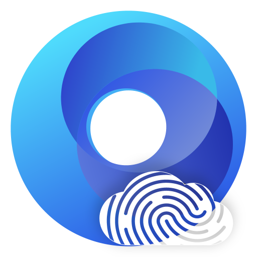

<p align="center">
  
</p>

<h1 align="center">YunLogin Browser Skill</h1>

<p align="center">
  Operate YunLogin environments through documented local, client, and management-center APIs.
</p>

<p align="center">
  <strong>English</strong> | <a href="README.zh-CN.md">简体中文</a>
</p>

<p align="center">Version 1.1.0 · MIT</p>

## Overview

This repository contains the `yunlogin-browser` Codex skill. It provides a documented, low-dependency way to manage YunLogin environments, accounts, cookies, proxies, groups, tags, tokens, and browser automation.

The skill deliberately separates three API surfaces:

| Surface | Origin | Purpose |
| --- | --- | --- |
| Local API | discovered loopback port, commonly `50213`, `/api/v2/...` | Environments, browser launch/stop, cookies, groups, proxies, and tags |
| Local client API | discovered loopback port, `/api/v1/...` | Local desktop helper operations such as GPU facts and environment cleanup |
| Management-center API | `https://d126447d359e70c0.yunlogin.com/v2/...` | Server-side environment, account, proxy, team, plan, and notice operations |

Do not silently switch surfaces. Read the relevant endpoint document before making a live request.

## Highlights

- **77 documented endpoints**: 23 local API routes and 54 management-center routes.
- **Environment lifecycle**: create, clone, update, group, tag, and delete environments with confirmation gates on mutations.
- **Workbench session**: re-read the management-center page's current token, user, and company before authenticated API calls; keep the validated snapshot outside the repository.
- **CDP automation**: launch a managed environment, connect over Chrome DevTools Protocol, and optionally pair the browser with the Playwright CLI.
- **Existing `fb.exe` support**: inspect a running Windows `fb.exe`, plan a relaunch with a loopback CDP port, and verify the endpoint before using it.
- **Safe by default**: dry runs, loopback-only local access, sensitive-field redaction, and explicit confirmation for destructive actions.

## Repository Layout

```text
yunlogin-browser/
  SKILL.md                 entry point and routing rules
  agents/openai.yaml       Codex UI metadata
  assets/                  icons used by the skill and README
  references/              endpoint documents and workflow guides
  scripts/                 zero-dependency Node.js commands
  scripts/lib/             shared helper modules
  scripts/dev/             documentation maintenance tooling
  LICENSE                  MIT license copy
```

## Requirements

- Node.js 22 or newer is recommended because the scripts use the built-in global `fetch` and `WebSocket` clients.
- A running YunLogin desktop client for local API access.
- A logged-in YunLogin Workbench with verified loopback CDP for authenticated management-center API access.
- Windows is required for `fb.exe` process inspection and relaunch commands.

No third-party npm packages are required.

## Installation

Install the skill with the Codex skill installer:

```text
scripts/install-skill-from-github.py --repo PenBo1/yunlogin-browser-skill --path yunlogin-browser
```

Or copy the `yunlogin-browser` folder into your Codex skills directory.

## Quick Start

Use Node.js JavaScript helpers to discover current client ports and guide startup. Port values are refreshed from YunLogin-owned listeners, not copied from examples. If no installation is located, the skill asks about a custom path and offers [YunLogin](https://www.yunlogin.com/?c=7fzh). See [startup guidance](yunlogin-browser/references/client-api/STARTUP.md) and [port evidence](yunlogin-browser/references/client-api/PORTS.md).

```powershell
# Discover current ports and desktop readiness
node scripts/yunlogin-ports.mjs
node scripts/yunlogin-client.mjs status
# Only after startup approval; select the discovered installation
node scripts/yunlogin-client.mjs start --exe 'C:\path\YunLogin.exe' --confirm-start
# Read an allowlisted client configuration summary
node scripts/yunlogin-client.mjs config --dry-run
node scripts/yunlogin-client.mjs config

# Check the Workbench management session (browser CDP attach does not require it)
node scripts/yunlogin-auth.mjs status
node scripts/yunlogin-auth.mjs sync-workbench --dry-run

# Launch a managed environment and save its CDP session
node scripts/yunlogin-cdp.mjs start --account-id <account-id> --output session.json

# Inspect a running Windows fb.exe process
node scripts/yunlogin-fb-cdp.mjs list --main-only
node scripts/yunlogin-fb-cdp.mjs inspect --browser-id Workbench

# Plan a Workbench relaunch with a dynamic loopback CDP port
node scripts/yunlogin-client.mjs start --dry-run

# Apply the relaunch after confirming that Workbench may close and reopen
node scripts/yunlogin-client.mjs start --confirm-restart

# Attach Playwright CLI to the verified current Workbench CDP URL
$state = node scripts/yunlogin-client.mjs status | ConvertFrom-Json
$cdp = $state.workbench.cdpUrl
playwright-cli -s=yunlogin-workbench attach --cdp=$cdp
playwright-cli -s=yunlogin-workbench tab-list
playwright-cli -s=yunlogin-workbench detach

# Read one management-center route
node scripts/yunlogin-server-api.mjs browser-settings

# Validate the documentation set
node scripts/dev/validate-api-docs.mjs
```

## Existing `fb.exe` CDP Relaunch

Windows cannot append command-line arguments to a process that is already running. `yunlogin-fb-cdp.mjs` therefore:

1. Finds the selected `fb.exe` main process.
2. Reads the existing command line without changing the process.
3. Redacts sensitive values such as `--base-data` by default.
4. Builds a replacement command line with the same arguments plus:
   - `--remote-debugging-address=127.0.0.1`
   - `--remote-debugging-port=<port>`
5. Requires `--confirm-restart` before stopping and starting the process.
6. Waits for `/json/version` and verifies `Browser.getVersion` over CDP.

The CDP endpoint is limited to loopback. Do not expose the debugging port to another host or network.

## Credentials

Tokens are never stored in this repository. The skill caches them in the user profile:

| Platform | Location |
| --- | --- |
| Windows | `%LOCALAPPDATA%\yunlogin-browser\` |
| Other | `~/.local/share/yunlogin-browser/` |

Never print, commit, or paste tokens into issues, logs, or generated documentation.

## Documentation

- Skill instructions: [yunlogin-browser/SKILL.md](yunlogin-browser/SKILL.md)
- API navigation: [yunlogin-browser/references/INDEX.md](yunlogin-browser/references/INDEX.md)
- CDP automation: [yunlogin-browser/references/workflows/cdp-automation.md](yunlogin-browser/references/workflows/cdp-automation.md)
- Playwright pairing: [yunlogin-browser/references/workflows/playwright-cli.md](yunlogin-browser/references/workflows/playwright-cli.md)
- Script reference: [yunlogin-browser/references/scripts.md](yunlogin-browser/references/scripts.md)
- Field inventory: [yunlogin-browser/references/server-api/FIELD_INVENTORY.md](yunlogin-browser/references/server-api/FIELD_INVENTORY.md)
- Test coverage: [yunlogin-browser/references/testing.md](yunlogin-browser/references/testing.md)

## License

MIT. See [LICENSE](LICENSE) at the repository root. The skill folder keeps an identical copy at [yunlogin-browser/LICENSE](yunlogin-browser/LICENSE) so an installed skill remains self-contained.
